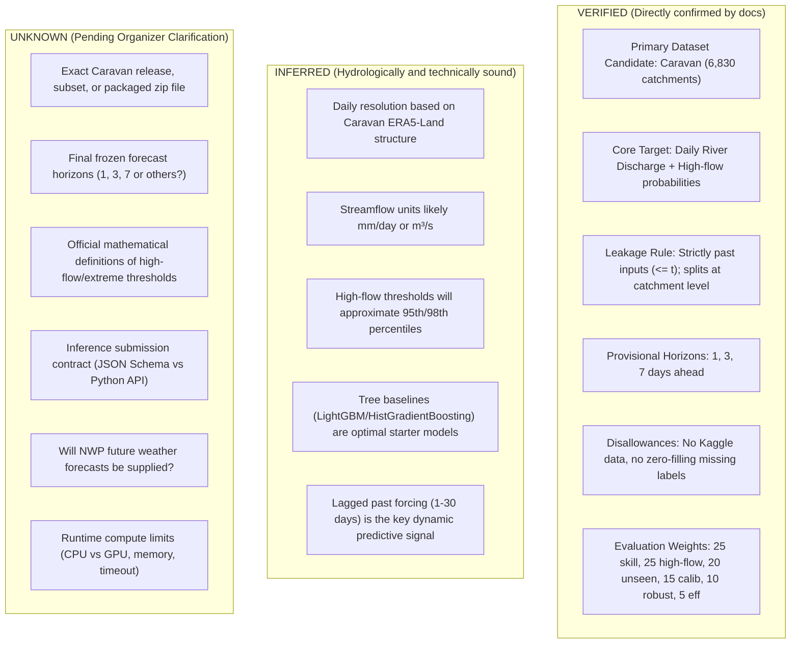

# BASINSHIFT · Data Audit & Problem Specification Report
**Role:** Data Auditor | Member 1: Model & Training  
**Date:** November 4, 2026  
**Status:** Complete Audit — Real-Data Ingestion Blocked (Dataset Package Pending)  
**Reference Documents:**  
- `BASINSHIFT_Full_Challenge_Documentation.pdf` (Version 1.0 Draft, 3 November 2026)  
- `BASINSHIFT_Final_Master_Plan_Rubric_Aligned.html` (Authoritative Master Execution Plan, Version 2.0)

---

## 1. Project File Inventory

An inspection of the workspace root (`D:\hackathon\basinshift`) and sibling project directories was conducted.

| Path | File Name | Size | Type / Format | Status & Description |
| :--- | :--- | :--- | :--- | :--- |
| `D:\hackathon\hackoween\` | `BASINSHIFT_Full_Challenge_Documentation.pdf` | 85,839 B | PDF Document (22 pages) | **Official Specification**: Version 1.0 Draft (3 Nov 2026). Defines research rationale, ML task, evaluation dimensions, judging rubric, and candidate dataset. |
| `D:\hackathon\hackoween\` | `BASINSHIFT_Final_Master_Plan_Rubric_Aligned.html` | 54,360 B | HTML Master Plan | **Authoritative Master Execution Plan**: Version 2.0 rubric-aligned plan (50 pts Model & repo, 20 pts Scalability, 30 pts Presentation) dividing responsibilities between Member 1 (Model & Training) and Member 2 (GitHub, App & PPT). |
| `D:\hackathon\basinshift\` | *(Active Workspace)* | — | Directory | **Active Workspace**: Root for project code, preprocessing pipelines, model artifacts, reports, and data folders. |

### Documented vs Missing Files
- **Official Specification:** `BASINSHIFT_Full_Challenge_Documentation.pdf` is present and verified.
- **Master Plan:** `BASINSHIFT_Final_Master_Plan_Rubric_Aligned.html` is present and verified as sole authoritative execution plan.
- **Data Package:** **MISSING**. No raw dataset files (`.csv`, `.parquet`, `.nc`, or `.zarr`) currently exist in `D:\hackathon\basinshift` or any sibling directories.
- **Kaggle Test Data:** Strictly excluded by project rules and not present in the workspace.

---

## 2. Approved Dataset Inventory

According to Section 6 of `BASINSHIFT_Full_Challenge_Documentation.pdf` and Section 2.1 of `BASINSHIFT_Final_Master_Plan_Rubric_Aligned.html`:

| Dataset Name | Candidate Status | Approved for Modeling? | Physical Presence in Workspace | Action Required |
| :--- | :--- | :--- | :--- | :--- |
| **Caravan** | Primary Candidate Resource | **Conditionally Approved** (pending organizer release and license verification) | **Absent** (0 rows, 0 files) | Obtain organizer-approved release package or sample before training. |
| **GloFAS** | Secondary / Comparative | Not approved as primary target; reference only | Absent | Do not use unless explicitly provided by organizers. |
| **Copernicus EMS** | Spatial extension (flood mapping) | **Out of Scope** for core discharge task | Absent | Not needed for core discharge modeling. |
| **Kaggle Test Data** | Excluded | **STRICTLY FORBIDDEN** | Absent | Do not inspect, download, or use under any circumstances. |

> [!CRITICAL]
> **Data Availability Gate:**
> Under Project Rules 2, 4, and 6, external data must not be scraped or downloaded independently, and columns or values must not be fabricated. Real-data model training is **BLOCKED** until the organizers provide the frozen Caravan dataset package and schema.

---

## 3. Dataset Schema Tables (Documented Caravan Architecture)

Because physical files are pending release, the following schema represents the verified architecture of the primary candidate dataset (**Caravan**, Kratzert et al., 2023, Nature Sci Data) as referenced in Section 6.1 and Section 8.2 of the official specification.

### 3.1. Dynamic Hydrological & Meteorological Time-Series (Daily)

Each catchment has an associated daily time-series of atmospheric drivers and observed streamflow:

| Column Group | Variable / Field | Data Type | Expected Units | Usage in BASINSHIFT | Availability at Inference Origin $t$ |
| :--- | :--- | :--- | :--- | :--- | :--- |
| **Identity** | `gauge_id` / `catchment_id` | String | Categorical | Primary catchment identifier | Available |
| **Temporal** | `date` / `timestamp` | Date / String | YYYY-MM-DD (UTC) | Time coordinate | Available |
| **Target / Hydro** | `streamflow` / `qobs` | Float32/64 | $\text{mm/day}$ or $\text{m}^3/\text{s}$ | Target variable (historical values used as autoregressive lag features) | **Past only ($\le t$)**; **NEVER** at $t+h$ |
| **Meteorology** | `total_precipitation` | Float32/64 | $\text{mm/day}$ | Dynamic meteorological forcing (ERA5-Land) | Past only ($\le t$) |
| **Meteorology** | `temperature_2m` | Float32/64 | $^\circ\text{C}$ or $\text{K}$ | Mean daily surface air temperature | Past only ($\le t$) |
| **Meteorology** | `dewpoint_temperature_2m`| Float32/64 | $^\circ\text{C}$ or $\text{K}$ | Humidity / dewpoint indicator | Past only ($\le t$) |
| **Meteorology** | `potential_evaporation` | Float32/64 | $\text{mm/day}$ | Atmospheric evaporative demand | Past only ($\le t$) |
| **Meteorology** | `surface_net_solar_radiation` | Float32/64 | $\text{J/m}^2$ or $\text{W/m}^2$ | Solar radiative forcing | Past only ($\le t$) |
| **Meteorology** | `surface_net_thermal_radiation` | Float32/64 | $\text{J/m}^2$ or $\text{W/m}^2$ | Thermal radiative forcing | Past only ($\le t$) |
| **Meteorology** | `snow_depth_water_equivalent` | Float32/64 | $\text{mm}$ | Snowpack storage / snowmelt driver | Past only ($\le t$) |

### 3.2. Static Catchment Descriptors ($A(c)$)

Caravan supplies static environmental, geophysical, and climatological attributes for each catchment:

| Attribute Category | Example Attributes | Data Type | Units / Range | Purpose in Transfer Learning |
| :--- | :--- | :--- | :--- | :--- |
| **Topography** | `area`, `mean_elevation`, `slope_mean` | Float32/64 | $\text{km}^2$, $\text{m}$, $\text{m/km}$ | Governs catchment response time and gravity-driven routing. |
| **Climate Indices** | `p_mean`, `aridity_index`, `fraction_snow` | Float32/64 | $\text{mm/day}$, ratio, $[0, 1]$ | Dictates baseline water balance and snowmelt dynamics. |
| **Soil & Geology** | `soil_depth`, `conductivity_mean`, `porosity` | Float32/64 | $\text{m}$, $\text{cm/hr}$, fraction | Governs infiltration capacity, saturation excess, and baseflow. |
| **Land Cover** | `forest_fraction`, `impervious_surface` | Float32/64 | Percentage / fraction | Influences interception, evapotranspiration, and surface runoff speed. |

---

## 4. Target Variable and Forecasting Problem

### 4.1. What Exactly Are We Predicting?
For a given catchment $c$ and a forecast origin date $t$, the system must predict:
1. **Continuous Discharge ($q(c, t+h)$):** Expected river discharge at horizons $h \in \{1, 3, 7\}$ days (provisional set). Discharge must be strictly non-negative ($\ge 0$).
2. **High-Flow Exceedance Probability ($P(q(c, t+h) > T_{\text{high}}(c))$):** A calibrated probability $[0, 1]$ that river flow exceeds the catchment's specific high-flow threshold.
3. **Extreme-Flow Exceedance Probability ($P(q(c, t+h) > T_{\text{extreme}}(c))$):** A calibrated probability $[0, 1]$ that river flow exceeds the extreme threshold.
4. **Uncertainty Prediction Intervals:** Bounded intervals $[\hat{q}_{\text{lower}}(c, t+h), \hat{q}_{\text{upper}}(c, t+h)]$ satisfying $\hat{q}_{\text{lower}} \le \hat{q}_{\text{median}} \le \hat{q}_{\text{upper}}$.

### 4.2. What Does One Row Represent?
- **In Training/Tabular Format:** One row represents an evaluation instance defined by `(catchment_id, forecast_origin_t)`. It pairs observations available up to $t$ with targets at future horizons $t+1, t+3, t+7$.
- **At Inference:** An input query specifies `catchment_id` and `forecast_origin`, alongside permitted past observations up to that timestamp.

### 4.3. Forecast Horizons
- **Provisional Horizons:** 1 day, 3 days, and 7 days ahead (Section 8.1 of PDF).
- **Status:** Unfinalized draft recommendation. Models must be designed with configurable horizons.

### 4.4. The Generalization Task: Unseen Catchments (Test B)
The central scientific challenge of BASINSHIFT is **geographic transfer**:
- The model will be evaluated on catchments that were **completely excluded from training** (Test Partition B).
- The model cannot simply memorize local rating curves or gauge quirks; it must learn universal mapping:
  $$\hat{q}(c, t+h) = f(X(c, \le t), A(c))$$

---

## 5. Features Usable at Inference Time vs. Leakage Risks

| Feature Group | Usable at Inference Origin $t$? | Conditions & Restrictions |
| :--- | :--- | :--- |
| **Historical Discharge ($q(c, \le t)$)** | **YES (when available)** | Only observations up to timestamp $t$. For ungauged basins or zero-history test catchments, the model must be robust to missing discharge history. |
| **Future Discharge ($q(c, t' > t)$)** | **STRICTLY FORBIDDEN** | Severe target leakage. Any lookahead will disqualify the model. |
| **Historical Weather Forcing ($X_{\text{met}}(c, \le t)$)** | **YES** | Preceding precipitation, temperature, radiation up to origin $t$. |
| **Future Weather Observations ($X_{\text{met}}(c, t+h)$)** | **STRICTLY FORBIDDEN** | Realized future weather observations do not exist at forecast origin $t$. |
| **Future Weather Forecasts (NWP)** | **PROVISIONALLY UNUSABLE** | The draft specification does not provide future numerical weather predictions (NWP). Unless organizers release official forecast forcings, future forcing cannot be used. |
| **Static Attributes ($A(c)$)** | **YES** | Catchment area, elevation, soil properties. Must be computed strictly from fixed reference datasets without target leakage. |
| **Catchment High-Flow Thresholds ($T(c)$)** | **RESTRICTED** | Must be derived strictly from training partitions or historical reference periods, never from validation or test periods. |
| **Scalers / Imputers / Preprocessing** | **RESTRICTED** | Must be fit strictly on training fold data and transformed on validation/inference data. |

---

## 6. Missing Data and Data-Quality Observations

The PDF highlights specific data-quality constraints (Section 6.4 and Section 16):

1. **Zero-Imputation Prohibition:** Never replace missing discharge values with zero. Zero in hydrology signifies a dry stream bed, not missing data.
2. **Gap Filling Rule:** Long gaps in continuous records must not be arbitrarily forward-filled. Missingness indicators/masks should be used instead.
3. **Quality Flags:** Real hydrological observations contain quality flags (e.g. sensor drift, frozen gauges, backwater effects). These flags must be retained and audited.
4. **Extreme Event Sparsity:** Extreme flood events represent $<1\%$ of historical time series. Unbalanced data requires precision-recall metrics (AUPRC) rather than basic accuracy.
5. **Physical Plausibility:** Predicted discharge cannot be negative. Negative discharge predictions violate conservation of mass and will be rejected by the evaluator schema.

---

## 7. Categorization of Information: Verified vs. Inferred vs. Unknown



### Table of Categorized Items

| Category | Item Description | Source / Evidence |
| :--- | :--- | :--- |
| **VERIFIED** | Task objective is streamflow forecasting and high-flow probability in unseen catchments. | PDF Sec 2.2, 5 |
| **VERIFIED** | Caravan is the primary candidate data source. | PDF Sec 6.1 |
| **VERIFIED** | Kaggle test data is completely out of scope. | PDF Sec 1.1, HTML alert |
| **VERIFIED** | Preprocessing, scalers, and thresholds must be fit on training data only. | PDF Sec 6.4, 7.2 |
| **VERIFIED** | Missing streamflow labels must NEVER be imputed with zero. | PDF Sec 6.4 |
| **VERIFIED** | Validation must separate temporal holdout from geographic (unseen catchment) holdout. | PDF Sec 7.1 |
| **VERIFIED** | Discharge predictions must be non-negative ($\ge 0$). | PDF Sec 8.4 |
| **INFERRED** | Caravan daily meteorological data will be ERA5-Land aggregations. | Kratzert et al., 2023 |
| **INFERRED** | Discharge units in Caravan are typically normalized as specific discharge ($\text{mm/day}$). | Standard Caravan convention |
| **INFERRED** | A baseline tree model (HistGradientBoosting / LightGBM) will provide the fastest benchmark. | HTML Phase 4 |
| **INFERRED** | 30-day lookback window for precipitation/temperature captures catchment lag time. | Standard hydrological ML literature |
| **UNKNOWN** | Exact file package and download link approved by the organizers for this competition. | Pending organizer release |
| **UNKNOWN** | Final approved forecast horizons (are they strictly 1, 3, 7 days?). | PDF Sec 8.1 |
| **UNKNOWN** | Exact formula and baseline values for the high-flow threshold $T(c)$. | PDF Sec 8.1, 10.2 |
| **UNKNOWN** | Exact submission schema (JSON structure, CLI arguments, or class interface). | PDF Sec 8.3 |
| **UNKNOWN** | Exact inference environment specs (max RAM, execution timeout, accelerator). | PDF Sec 9.4 |

---

## 8. Critical Questions for Organizers

Before Member 1 can begin pipeline implementation and model training, the following questions must be answered:

1. **Dataset Location & Version:** Where is the official BASINSHIFT dataset package hosted, and which exact Caravan release/files are designated for this sprint?
2. **Horizon Freeze:** Are the official forecast horizons finalized as $h \in \{1, 3, 7\}$ days, or will other lead times be evaluated?
3. **Threshold Definition:** How are the catchment-specific high-flow and extreme-flow thresholds defined (e.g., historical 95th/98th percentiles, or return periods)?
4. **Meteorological Forcing Scope:** Are participants expected to predict solely using past meteorological forcings ($t' \le t$), or will numerical weather forecast forcings ($t < t' \le t+h$) be provided?
5. **Submission Schema:** What is the precise machine-readable schema required for submission (JSON keys, data types, file format)?

---

## 9. Recommendations for Member 1 Next Implementation Steps

1. **Project Directory Scaffolding:**  
   Initialize the standard folder layout in `D:\hackathon\basinshift`:
   ```
   basinshift/
   ├── data/
   │   ├── raw/           # Preserved unmodified
   │   └── processed/     # Versioned transformed features
   ├── src/
   │   ├── audit_data.py
   │   ├── features.py
   │   ├── train_forecast.py
   │   └── predict.py
   ├── models/            # Saved model artifacts (.joblib)
   ├── reports/           # Data audit, metrics, and split manifests
   ├── docs/              # Requirements, schemas, provenance
   └── tests/             # Unit and leakage tests
   ```

2. **Wait for Approved Raw Data Package:**  
   Do not download unapproved third-party datasets or train models on arbitrary data. As soon as the organizer provides the dataset archive, place it in `data/raw/` without modification.

3. **Develop Leakage-Safe Feature Functions:**  
   Prepare the schema validator and past-only rolling feature extractor (`src/features.py`) strictly enforcing $t' \le t$.

4. **Coordinate with Member 2:**  
   Agree on the feature output contract and validation split manifest (`reports/split_manifest.csv`) before fitting the persistence and gradient-boosted baseline models.

---
*Report prepared by Member 1 Data Auditor.*

