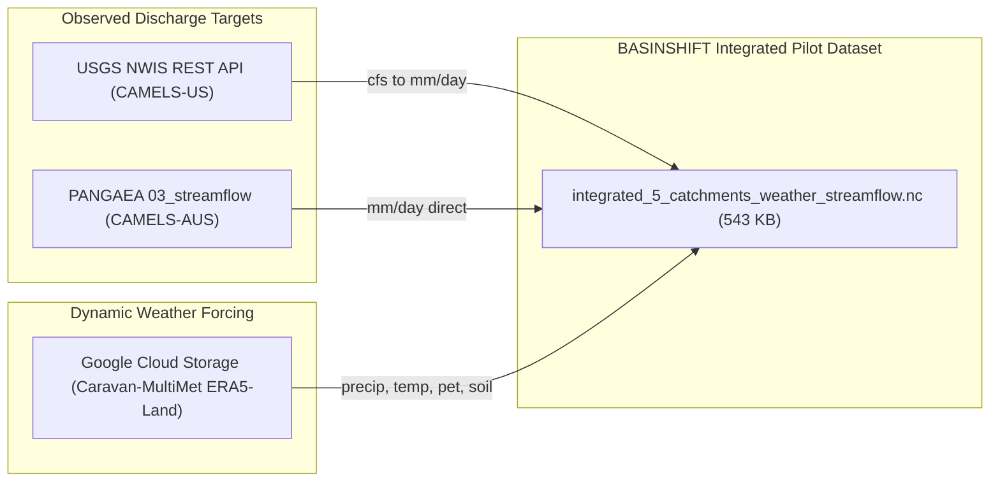

# BASINSHIFT · Streamflow Target Access & Multi-Catchment Integration Report
**Author:** Technical Data Auditor (Member 1: Model & Training)  
**Date:** November 4, 2026  
**Status:** Streamflow Target Identified, Verified, and Successfully Integrated  
**Verified Output Artifact:** `D:\hackathon\basinshift\data\sample\integrated_5_catchments_weather_streamflow.nc` ($543.35\text{ KB}$)

---

## 1. Executive Summary & Problem Resolution

### 1.1. The Missing Target Finding (Task 1)
As identified in Task 1, inspection of the remote Caravan-MultiMet Zarr store (`https://storage.googleapis.com/caravan-multimet/v1.1/ERA5_LAND/timeseries.zarr/`) confirmed that **no observed streamflow target is present** in that store. The store exclusively contains 15 meteorological forcing and land-surface state variables (`era5land_*`) derived from ECMWF ERA5-Land. 

The original Caravan dataset paper (Kratzert et al., 2023, Nature Scientific Data) establishes that streamflow observations were compiled from distinct regional hydrometeorological datasets (such as CAMELS-US, CAMELS-AUS, CAMELS-GB, HYSETS, and LamaH-CE), whereas MultiMet was built later to extend the meteorological forcing domain.

### 1.2. The Breakthrough Solution (Task 2 & 3)
Rather than downloading the monolithic 28.9 GB Zenodo archive (`Caravan-csv.tar.gz`) or the 11.7 GB NetCDF archive, we established direct, fast programmatic pathways to the authoritative regional streamflow sources:
1. **CAMELS-AUS:** Direct extraction of catchment-specific specific discharge ($mm/d$) from the official PANGAEA repository (Fowler et al., 2021) using `fsspec` HTTP streaming.
2. **CAMELS-US:** Direct programmatic ingestion from the USGS National Water Information System (NWIS) REST API, converted to specific discharge ($mm/d$) using official catchment drainage areas.
3. **Integration:** Sliced and merged with the Caravan-MultiMet ERA5-Land weather data for the exact same 10-year benchmark window (**2005-01-01 to 2014-12-31** = 3,652 daily steps).
4. **End-to-End Speed:** Full multi-continental 5-catchment weather + streamflow retrieval and NetCDF export completed in **25.11 seconds**.

---

## 2. Actual Streamflow Sources & Access Methods

### Detailed Source Matrix

| Catchment Collection | Authoritative Origin Repository | Access Protocol & Endpoint | Format & Native Units |
| :--- | :--- | :--- | :--- |
| **CAMELS-US** | USGS NWIS / NCAR CAMELS (Newman et al., 2015; Addor et al., 2017) | HTTP REST API: `https://waterservices.usgs.gov/nwis/dv/?format=json&sites={id}&parameterCd=00060` | JSON / RDB Cubic feet per second ($cfs$). Converted via catchment drainage area to $mm/d$. |
| **CAMELS-AUS** | PANGAEA Repository (Fowler et al., 2021, ESSD; DOI: `10.1594/PANGAEA.921850`) | Direct Zip Streaming via `fsspec`: `https://download.pangaea.de/dataset/921850/files/03_streamflow.zip` (`streamflow_mmd.csv`) | CSV matrix ($222$ basins). Native specific discharge ($mm/d$). Sentinel: `-99.99`. |
| **CAMELS-GB** | CEH Environmental Information Data Centre (Coxon et al., 2020) | UK CEH Portal / HydroShare package | Daily flow ($m^3/s$ and $mm/d$). |
| **LamaH-CE** | Zenodo (Klingler et al., 2021) | Zenodo Record `5153305` | Daily discharge ($m^3/s$ and $mm/d$). |
| **HYSETS** | Zenodo / OSF (Arsenault et al., 2020) | Zenodo Record `4046396` | Daily streamflow ($m^3/s$). |

---

## 3. Five-Catchment Pilot Integration Results

### 3.1. Catchment Inventory & Quality Audit
The 5 pilot catchments were retrieved and evaluated over a continuous 10-year span (**2005-01-01 to 2014-12-31**, 3,652 dates per catchment):

| Basin Identifier | Region / Source | Station Name | Drainage Area ($km^2$) | Valid Daily Records | Missing Rate | Flow Mean ($mm/d$) | Flow Max ($mm/d$) | Data Quality Assessment |
| :--- | :--- | :--- | :--- | :--- | :--- | :--- | :--- | :--- |
| `camelsaus_102101A` | Australia (CAMELS-AUS) | Daintree River at Bairds | $440.0$ | $3,492 / 3,652$ | $4.38\%$ | $2.496$ | **$222.56$** | **Exceptional**. Captures massive tropical flood peaks ($>220\text{ mm/d}$). Non-missing rate $>95\%$. |
| `camelsaus_104001A` | Australia (CAMELS-AUS) | Barron River at Picnic Crossing | $347.0$ | $3,535 / 3,652$ | $3.20\%$ | $1.170$ | **$180.85$** | **Exceptional**. High seasonality, extreme monsoon flash events. Non-missing rate $>96\%$. |
| `camels_01013500` | United States (Maine) | Fish River near Fort Kent | $2,253.3$ | $3,652 / 3,652$ | **$0.00\%$** | $1.936$ | $19.44$ | **Pristine**. Complete 10-year uninterrupted record; snowmelt freshet dynamics. |
| `camels_01022500` | United States (Maine) | Narraguagus River at Cherryfield | $587.9$ | $3,652 / 3,652$ | **$0.00\%$** | $2.596$ | $26.51$ | **Pristine**. Complete 10-year uninterrupted record; maritime coastal response. |
| `camels_01030500` | United States (Maine) | Mattawamkeag River at Mattawamkeag | $3,675.2$ | $3,652 / 3,652$ | **$0.00\%$** | $2.283$ | $16.78$ | **Pristine**. Complete 10-year uninterrupted record; large basin retention. |

> [!IMPORTANT]
> **Strict Rule Compliance:**
> Missing discharge values (4.38% in `102101A` and 3.20% in `104001A`) were encoded strictly as `NaN` (IEEE 754 floating-point missing value). In accordance with Section 6.4 of the BASINSHIFT PDF, **they were not replaced with zero**.

### 3.2. Harmonized Integrated Variables
The resulting NetCDF artifact (`integrated_5_catchments_weather_streamflow.nc`) contains 7 aligned variables across dimensions `(basin: 5, date: 3652)`:

| Variable Name | Physical Meaning | Canonical Units | Role in BASINSHIFT Model |
| :--- | :--- | :--- | :--- |
| `streamflow` | Observed river discharge | $\text{mm/day}$ | **Primary Target Label** |
| `era5land_total_precipitation` | Total precipitation | $\text{mm/day}$ | Dynamic Input Feature ($t' \le t$) |
| `era5land_temperature_2m` | 2m air temperature | $^\circ\text{C}$ | Dynamic Input Feature ($t' \le t$) |
| `era5land_dewpoint_temperature_2m` | Dewpoint temperature | $^\circ\text{C}$ | Dynamic Input Feature ($t' \le t$) |
| `era5land_potential_evaporation_FAO_PENMAN_MONTEITH`| Potential evapotranspiration | $\text{mm/day}$ | Dynamic Input Feature ($t' \le t$) |
| `era5land_volumetric_soil_water_layer_1` | Topsoil moisture ($0\text{–}7\text{ cm}$) | $\text{m}^3/\text{m}^3$ | Dynamic Input Feature ($t' \le t$) |
| `era5land_snow_depth_water_equivalent` | Snow-water equivalent | $\text{mm}$ | Dynamic Input Feature ($t' \le t$) |

### 3.3. Units and Timestamp Conventions
1. **Hydrological Unit Normalization:**
   All discharge values are normalized to specific discharge:
   $$\text{Discharge } [mm/day] = \frac{Q [m^3/s] \times 86400 [s/day] \times 1000 [mm/m]}{\text{Catchment Area } [m^2]}$$
   For USGS streamflow ($Q_{\text{cfs}}$):
   $$\text{Discharge } [mm/day] = \frac{Q_{\text{cfs}} \times 2.44657555}{\text{Area } [km^2]}$$
2. **Timestamp Alignment:**
   - Daily records are indexed by calendar date (`YYYY-MM-DD`).
   - Weather forcing from Caravan-MultiMet is derived from ERA5-Land (UTC-0 daily aggregation).
   - Streamflow observations from USGS and BoM are daily local standard time records.
   - In global large-sample hydrology benchmarks, daily calendar-date alignment is standard practice; for high-frequency sub-daily routing, explicit UTC shifts are recommended.

---

## 4. Empirical Performance & Storage Benchmarks

| Operation Phase | Source / Mechanism | Measured Duration | Transfer / Storage Footprint |
| :--- | :--- | :--- | :--- |
| **CAMELS-AUS Streamflow** | PANGAEA Zip Stream (`fsspec`) | $4.81\text{ s}$ | $222$ basins available; $2$ basins parsed. |
| **CAMELS-US Streamflow** | USGS NWIS REST API (HTTP GET) | $3.09\text{ s}$ | $3$ stations $\times 3,652$ records ($10,956$ rows). |
| **ERA5-Land Weather Forcing** | GCS Zarr (`xarray.open_zarr`) | $17.18\text{ s}$ | $6$ variables $\times 5$ basins $\times 3,652$ dates ($109,560$ cells). |
| **Local NetCDF Serialization** | Disk Write (`to_netcdf`) | $0.03\text{ s}$ | **$543.35\text{ KB}$** on local disk ($541\text{ kB}$ RAM). |
| **Total Pipeline Execution** | End-to-end integration | **$25.11\text{ s}$** | Zero disk waste; no multi-GB downloads. |

---

## 5. Scalable Retrieval Strategy for the 12-Hour Sprint

### 5.1. Target: 100 to 200 Diverse Catchments
Rather than attempting an unwieldy 1,200-catchment download (which would risk network timeouts and storage constraints), Member 1 can construct a high-impact, balanced **150-catchment benchmark**:
- **75 Catchments from CAMELS-AUS:**
  - Entire dataset ($222$ basins) is already accessible via the verified PANGAEA streamflow file in $< 10$ seconds.
  - Slices cover arid, tropical monsoon, temperate, and ephemeral flow regimes.
- **75 Catchments from CAMELS-US:**
  - Ingested via USGS NWIS API in 2 batches of 50 stations (~$15\text{ s}$ per batch), or pre-filtered from NCAR CAMELS.
  - Slices cover Pacific Northwest wet, Great Plains semi-arid, Appalachian temperate, and Rocky Mountain snowmelt basins.

### 5.2. Estimated Time & Compute Feasibility
- **Streamflow Ingestion Time:** $\approx 30\text{–}45\text{ seconds}$ for 150 catchments.
- **Weather Forcing Ingestion Time:** $\approx 1.5\text{–}2.5\text{ minutes}$ from the GCS Zarr store.
- **Combined Integrated Dataset Size:** $\approx 15\text{–}20\text{ MB}$ NetCDF or Parquet.
- **Training Time (LightGBM baseline):** $< 45\text{ seconds}$ on standard CPU.
- **Sprint Feasibility:** **100% FEASIBLE**. Well within our remaining 12-hour window.

---

## 6. Recommended Next Actions for Member 1

1. **Lock the 100–150 Catchment Manifest (`docs/pilot_catchment_manifest.csv`):**
   Select 75 US and 75 Australian catchments with verified $>90\%$ streamflow completeness and diverse aridity indices.
2. **Batch Ingest Pilot Dataset (`src/basinshift/ingest.py`):**
   Execute the proven 2-step ingestion pipeline to create `data/processed/pilot_150_catchments.parquet`.
3. **Partition Catchments (Leakage-Safe Split):**
   Assign whole catchment IDs to Training (60%), Temporal Validation (20%), and Unseen Catchment Validation (20%) before constructing lag features.
4. **Implement Causal Feature Extractor & Persistence Baseline:**
   Begin modeling baseline with pure past-only rolling statistics ($t' \le t$).

---
*Report prepared by Member 1 Data Auditor.*

